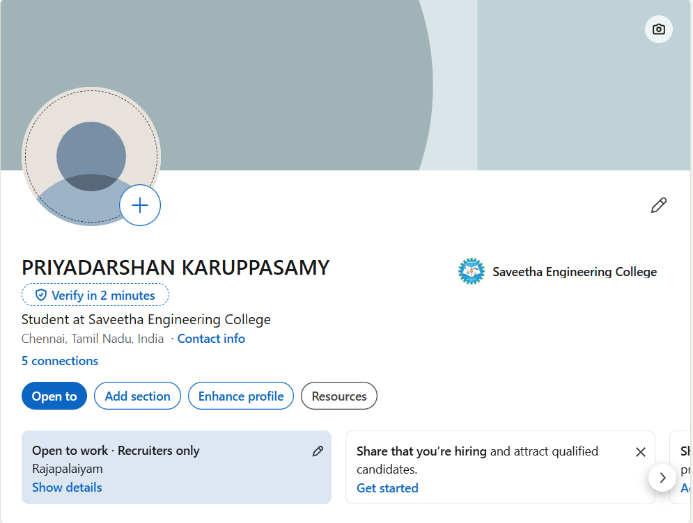

# Ex. No. 11 — Creating a Simple Professional Profile Page on LinkedIn

## AIM
To understand the importance of a professional online presence and create a simple, complete, and professional LinkedIn profile highlighting academic and professional details in a clear and organised manner.

## INTRODUCTION
LinkedIn is a professional networking platform used by students, faculty, and working professionals to showcase their education, skills, and experience; connect with peers and recruiters; and discover jobs, internships, and industry updates.

A well-maintained LinkedIn profile acts as an online resume. It should be accurate, complete, and presented in a clean, readable format.

## TOOLS REQUIRED
- Web browser (Google Chrome or Microsoft Edge) or the LinkedIn mobile app
- Valid email address or phone number
- Recent, clear profile photograph
- Prepared information about education, skills, and experience
- Optional: background or cover image related to the institution or field

## PROCEDURE

### Step 1: Prepare Your Information
Prepare the following details in a document before creating the profile:
- Full name and current designation
- Institution name and location
- Short About summary (3–4 lines)
- Educational qualifications
- Work experience, if applicable
- Key skills

### Step 2: Sign Up on LinkedIn
1. Open a browser and visit [www.linkedin.com](https://www.linkedin.com).
2. Click **Join now**.
3. Enter your email address or phone number and create a secure password.
4. Enter your first and last name.
5. Verify your account using the OTP or confirmation link sent to your email or phone.

### Step 3: Add a Profile Photo and Background Image
1. Log in and select **View Profile** from the profile menu.
2. Click the camera icon in the profile photo area and upload a clear, recent photograph.
3. Click the camera icon in the banner area to upload a suitable background image, such as a campus photo or subject-related graphic.

### Step 4: Add Name, Headline, and Location
Click the edit (pencil) icon near your name and enter:
- **Name:** Your full name
- **Headline:** A concise description of your role or professional focus
- **Location:** Your city and country

Example headline: *Electronics and Communication Engineering Student at Saveetha Engineering College*

### Step 5: Write the About Section
1. Scroll to the **About** section.
2. Select **Add profile section** and choose **About**.
3. Write 3–5 sentences describing your role, interests, and areas of focus.
4. Use clear, professional language and avoid unnecessary jargon.

### Step 6: Add Education Details
1. Select **Add profile section → Education**.
2. Enter the institution, degree, field of study, and start and end years.
3. Add qualifications in reverse chronological order, starting with the most recent.

### Step 7: Add Experience Details
1. Select **Add profile section → Experience**.
2. For each role, enter the job title, organisation, employment type, location, and duration.
3. Add a brief description of responsibilities.
4. List roles in reverse chronological order. If you have no formal work experience, leave this section empty or add relevant experience only when applicable.

### Step 8: Add Skills
1. Select **Add profile section → Skills**.
2. Add relevant and accurate skills, such as Python, Artificial Intelligence, Machine Learning, or Teaching, depending on your background.
3. Prioritise skills that reflect your actual knowledge and experience.

### Step 9: Review Profile and Privacy Settings
1. Review the profile for completeness and accuracy.
2. Check LinkedIn's profile-strength suggestions and complete relevant missing sections.
3. Open **Settings → Visibility** to manage which profile details are visible publicly and to connections.

### Step 10: Publish and Share the Profile
1. Select **View Profile** and review how the profile appears.
2. Use **Share profile** or **Copy link to profile** to obtain a shareable URL.
3. Add the link to your resume, email signature, or other professional materials if appropriate.

## SAMPLE OUTPUT

The screenshot below shows my LinkedIn profile page.

## OUTPUT
A professional LinkedIn profile is created with a profile photo, background banner, headline, About summary, Education, Experience, and Skills sections, and is ready to be shared through a profile link.

## RESULT
Thus, a simple and professional LinkedIn profile page was successfully created with the essential sections completed and the profile ready for sharing.

## CONCLUSION
Creating a LinkedIn profile is an important step in building a professional online identity. By presenting accurate information in the Photo, Headline, About, Education, Experience, and Skills sections, students and faculty can introduce themselves professionally to recruiters, peers, and the wider academic and industry community.
